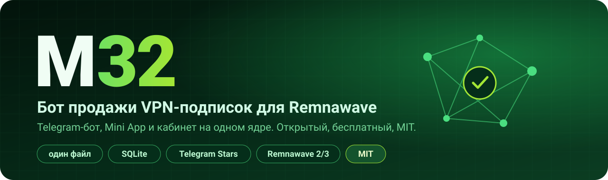
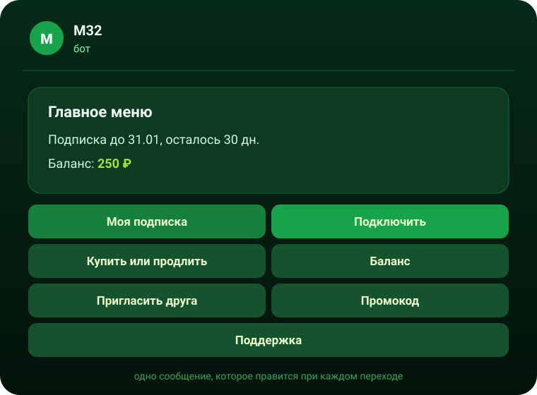
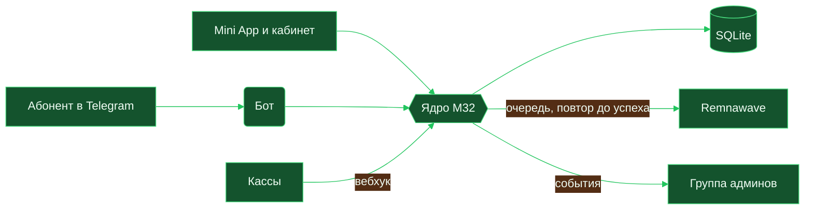

<p align="center">
  
</p>

<p align="center">
  <a href="https://github.com/bini69-oi/Worker/actions/workflows/ci.yml"></a>
  
  
  
  
</p>

<p align="center">
  <b>Абонент покупает VPN в Telegram за минуту. Владелец видит деньги и людей в своей группе.</b><br>
  Один файл, одна база, никаких пяти контейнеров.
</p>

---

## 🟢 Что умеет бот

<table>
<tr>
<td width="55%" valign="top">

**Для абонента**

- 🎁 **Пробный период одной кнопкой.** По желанию только для подписчиков вашего канала.
- 🛒 **Покупка в три шага:** тариф, срок, «Оплатить». Не хватает денег? Бот пишет, сколько именно, пополняете на разницу, и подписка оформляется сама.
- 🚀 **Подключение одной кнопкой.** Нажал «Добавить в Happ», приложение открылось и подписка уже в нём. Никаких ссылок руками.
- 📱 **Устройства:** список из панели, отвязать одно или все, перевыпустить ссылку.
- 💰 **Баланс и история,** промокоды кнопкой и ссылкой, рефералка с заработком.
- 🔁 **Автопродление** с баланса или звёздами Telegram каждый месяц.
- 💬 **Поддержка:** просто написать боту, ответ придёт сюда же.
- 🔔 **Бот сам напомнит,** что подписка заканчивается, и скажет, чем кончилась каждая оплата. Тишины нет.

</td>
<td width="45%" valign="top">



</td>
</tr>
</table>

**Для владельца и команды**

| | |
|---|---|
| 📊 **События по темам группы** | Платежи, Пробные, Новые, Поддержка, Ошибки, Безопасность, Сводка. Каждую тему включаете сами. |
| ⚡ **Кнопки под событием** | «Бан», «+7 дней», «Открыть в админке» прямо под оплатой или новым абонентом. |
| 💬 **Поддержка без системы заявок** | Сообщения абонентов приходят в тему «Поддержка» с карточкой: тариф, срок, баланс. Отвечаете реплаем. |
| 👥 **Помощники с правами** | Каждому только то, что отмечено: абоненты, деньги, бан, промокоды, тарифы, рассылки, поддержка. |
| 🛠 **Техработы кнопкой** | Абоненты видят текст о работах, оплаты и панель продолжают работать. |

**Оплата**

ЮKassa, Telegram Stars с автоподпиской, CryptoBot, Platega, ручной перевод с подтверждением.
Новая касса добавляется одним файлом по [инструкции](docs/add-gateway.md).

## 🛡 Почему ему можно доверить деньги

- **Деньги не теряются и не списываются дважды.** Каждое зачисление проверяется по номеру платежа, повтор вебхука ничего не добавит. Оплата звёздами записывается до ответа Telegram: сбой сервера не съест платёж.
- **Бота не угнать одной кражей.** Вход в админку паролем и выбором кода в Telegram. Ключи касс, реквизиты и список админов меняются только после «Да» владельца.
- **Секреты не утекают.** Ключи в базе зашифрованы, журнал вычищает их из каждой строки, ссылка подписки не светится в адресах.
- **Каждое действие админа записано.** Владелец узнаёт о входах, подборе паролей и смене ключей сразу.

## ⚙️ Как устроен



- **Один бинарник на Go и одна база SQLite.** Около 30-50 МБ памяти, запуск меньше секунды, бэкап это копия файла.
- **База главная, панель догоняет.** Деньги и срок подписки пишутся одной транзакцией, панель получает изменения через очередь. Упала панель? Покупка всё равно прошла, панель догонит.
- **Логика в одном месте.** Бот, Mini App и кабинет зовут одно ядро: покупка написана один раз и закрыта тестами один раз.
- **Всё настраивается без кода.** В `.env` только токен, ваш ID, адреса и ключ. Тарифы, тексты, кассы, темы живут в базе и меняются без перезапуска.

## 🚀 Запуск

На сервере с Debian 12+ или Ubuntu 22.04+ Worker ставится одной командой (подпись релиза проверяется до установки,
служба работает в песочнице systemd, https даёт Caddy):

```bash
curl -fsSL https://raw.githubusercontent.com/bini69-oi/worker/main/install/install.sh | sudo bash
```

Обновление: `sudo worker update` (с бэкапом и откатом). Бэкапы зашифрованы и делаются раз в сутки сами. Подробно:
[установка](docs/install.md), [выпуск релизов](docs/release.md).

Из исходников, для разработки:

```bash
git clone https://github.com/bini69-oi/Worker.git && cd Worker
cp .env.example .env && chmod 600 .env   # токен бота, ваш Telegram ID, адрес, панель, ключ
make build
./bin/worker
```

Боту нужен адрес с https для вебхука. Для запуска на своём компьютере без https есть режим опроса
(настройка `bot.polling`, переключатель появится в админке).

## 🗺 Где мы сейчас

| Часть | Что внутри | |
|---|---|---|
| **Ядро** | тарифы, подписки, баланс, промокоды, рефералка, кассы, Remnawave 2.x и 3.x, безопасность | ✅ готово |
| **Текстовый бот** | всё, что выше в «Что умеет бот» | ✅ готово, идёт ручная проверка |
| **Кабинет** | Mini App в Telegram и сайт в браузере, вход через бота | 🛠 следующий |
| **Админка** | абоненты, платежи, рассылки, тексты, настройки, команда, журнал | 📋 спека готова |
| **Установка** | одна команда, обновление, бэкап | 🛠 код готов, идёт проверка на сервере |

Подробно: [план](docs/roadmap.md) и [карта функций](docs/features.md).

## 📚 Документация

- [Решения](docs/decisions.md): почему Go, SQLite и один бинарник
- [Карта функций](docs/features.md): что в первой версии, что позже, чего не делаем
- [Как мы разрабатываем](docs/development.md): тест первым, ревью тремя взглядами. Правила для ИИ-агентов в [AGENTS.md](AGENTS.md)
- [Установка и обновление](docs/install.md), [выпуск релизов](docs/release.md)
- [Как добавить кассу](docs/add-gateway.md)
- [Спеки](openspec/): что именно делает каждая часть ([OpenSpec](https://github.com/Fission-AI/OpenSpec))

Перед коммитом: `make check` (gofmt, vet, staticcheck, тесты с `-race`), уязвимости: `make vuln`. CI запускает обе.

## 📄 Лицензия

MIT. Пользуйтесь, меняйте, продавайте.
